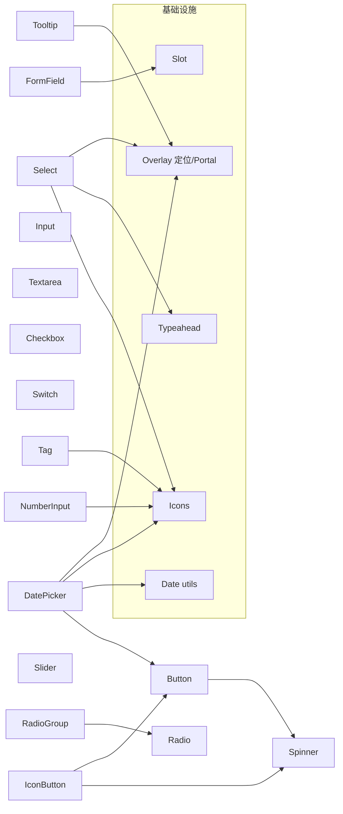
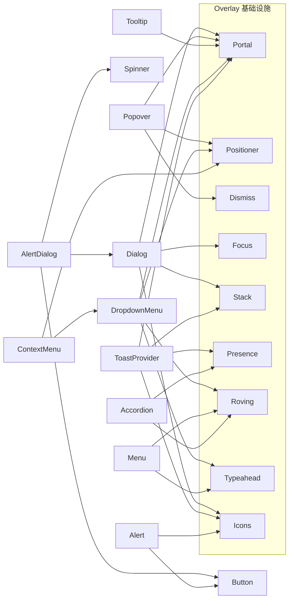
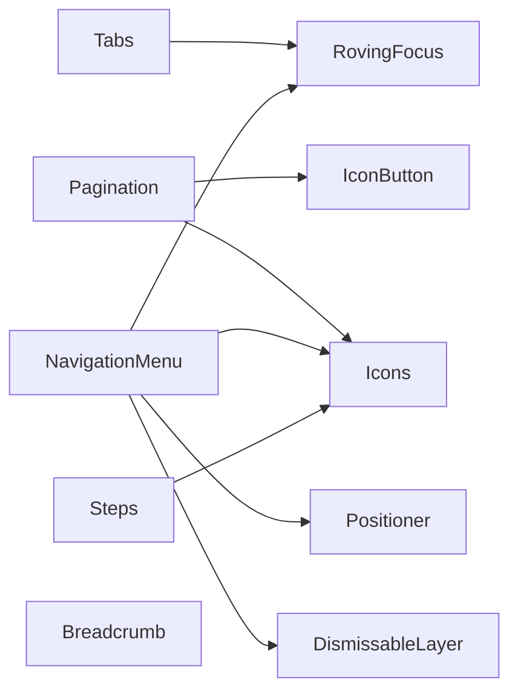
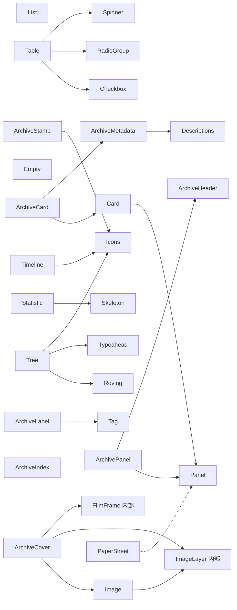

# 组件依赖关系设计

> 状态：草案。依赖方向是架构约束，不是实现建议。

## 1. 分层

```text
内部基础设施（不可公开导入）
  ├─ Portal / Positioner / DismissableLayer / FocusScope / LayerStack / Presence
  ├─ RovingFocus / Typeahead / Slot / Icons / 日期工具
  └─ useControllableState / useId / cn / ref 合并

Foundation（只依赖 Token 与工具）
  └─ Typography

Primitive（M1）
  └─ Button / IconButton / Spinner / Skeleton / Divider / Badge / Tag / Avatar

Form（M2）
  └─ Input / Textarea / Checkbox / Radio / RadioGroup / Switch / Select / NumberInput / Slider / DatePicker / FormField

Composite（M3）
  ├─ 反馈与浮层：Dialog / AlertDialog / Popover / DropdownMenu / ContextMenu / Menu / Toast / Alert / Progress / Accordion
  ├─ 导航：Tabs / Breadcrumb / Pagination / NavigationMenu / Steps
  └─ 数据展示：Panel / Card / List / Table / Timeline / Empty / Descriptions / Image / Statistic / Tree

Archive（M4）
  └─ ArchiveCard / ArchivePanel / ArchiveHeader / ArchiveMetadata / ArchiveStamp / ArchiveCover / ArchiveIndex
     （ArchiveLabel / ImageLayer / FilmFrame / PaperSheet 待确认）
```

规则：

- Foundation 不依赖任何具体组件。
- Primitive 只依赖更低的 Foundation / 内部基础设施。
- Form 不依赖 Composite / Archive。
- Composite 可依赖公开的 Primitive / Form；数据展示可依赖 Form（如 Table → Checkbox）。
- Archive 可依赖前三层公开 API；禁止反向依赖。
- 同层依赖必须单向：Panel 低于 Card；Radio 低于 RadioGroup；Dialog 内部低于 AlertDialog。

## 2. 高层依赖图

```mermaid
graph TD
  subgraph Infra[内部基础设施]
    Portal[Portal]
    Pos[Positioner]
    Dismiss[DismissableLayer]
    Focus[FocusScope]
    Stack[LayerStack]
    Presence[Presence]
    Roving[RovingFocus]
    Typeahead[Typeahead]
    Slot[Slot]
    Icons[Icons]
    Dates[Date utils]
  end

  subgraph Foundation[Foundation]
    Typography
  end

  subgraph Primitives[M1 Primitive]
    Button
    IconButton
    Spinner
    Skeleton
    Divider
    Badge
    Tag
    Avatar
    Tooltip
  end

  subgraph Forms[M2 Form]
    Input
    Textarea
    Checkbox
    Radio
    RadioGroup
    Switch
    Select
    NumberInput
    Slider
    DatePicker
    FormField
  end

  subgraph Composites[M3 Composite]
    Dialog
    AlertDialog
    Popover
    DropdownMenu
    ContextMenu
    Menu
    ToastProvider
    Alert
    Progress
    Accordion
    Tabs
    Breadcrumb
    Pagination
    NavigationMenu
    Steps
    Panel
    Card
    List
    Table
    Timeline
    Empty
    Descriptions
    Image
    Statistic
    Tree
  end

  subgraph Archive[M4 Archive]
    ArchiveCard
    ArchivePanel
    ArchiveHeader
    ArchiveMetadata
    ArchiveStamp
    ArchiveCover
    ArchiveIndex
  end

  Tooltip --> Pos
  Tooltip --> Portal
  Select --> Pos
  Select --> Typeahead
  DatePicker --> Pos
  DatePicker --> IconButton
  FormField --> Slot
  RadioGroup --> Radio
  Dialog --> Focus
  AlertDialog --> Dialog
  DropdownMenu --> Roving
  ContextMenu --> DropdownMenu
  Menu --> Roving
  NavigationMenu --> Pos
  Table --> Checkbox
  Table --> RadioGroup
  Card --> Panel
  ArchiveCard --> Card
  ArchivePanel --> Panel
  ArchivePanel --> ArchiveHeader
  ArchiveMetadata --> Descriptions
  ArchiveCover --> Image
  ArchiveStamp --> Icons
```



> 层级方向为 Infrastructure → Foundation → Primitive → Form → Composite → Archive；上图只画了关键跨层边，省略的层级关系见 §3 的分域图。组合层消费排版 Token 不表示所有组件都 import Typography；实现层优先用 CSS 类，避免组件间样式耦合。

## 3. 分域依赖图

### 3.1 M1 + M2



- Input / Textarea / Checkbox / Radio / Switch 不互相依赖。
- FormField 不 import 任何表单控件；它通过 Slot 向子元素注入属性，避免 FormField ↔ Input 循环。
- NumberInput 不依赖 Input 组件；可共享控件样式变量。
- Select 不依赖 Popover/DropdownMenu；它有自己的 listbox 语义。
- DatePicker 使用 Button/IconButton 做触发器/导航，但不依赖 Popover。

### 3.2 M3 反馈与浮层



`DropdownMenu` / `ContextMenu` / `Menu` 共享内部 `menu-core` 与 `MenuEntry` 类型；`MenuEntry` 应放在中立内部模块（如 `src/internal/menu/types.ts`）并由主入口导出类型，**不要让 Menu 从 DropdownMenu 目录导入运行时模块**，否则会形成组件间不必要的耦合。

### 3.3 M3 导航



Breadcrumb 无组件依赖；Menu 见反馈域（与 DropdownMenu 共享核心），不在此重复。

### 3.4 M3 数据展示 + M4 Archive



虚线表示“若保留独立组件”的建议关系；默认建议 ArchiveLabel 并入 Tag、ImageLayer/FilmFrame/PaperSheet 内部化。

## 4. 依赖清单（非平凡部分）

| 组件 | 必须依赖 | 可选依赖 | 禁止依赖 |
| --- | --- | --- | --- |
| Button | Spinner、内部 cn | Icon（consumer） | Tooltip、IconButton、Popover |
| IconButton | Button（样式/行为）、Spinner | Tooltip（consumer 组合） | Popover、Dialog |
| Tooltip | 内部 OverlayPortal/Positioner/Presence | — | Button、IconButton |
| FormField | 内部 Slot、useId | — | 任何具体表单控件 |
| RadioGroup | Radio（context） | — | Select、Checkbox |
| Select | 内部 Overlay/Typeahead/Icons | FormField | DropdownMenu、Menu |
| DatePicker | 内部 Overlay/日期工具/Icons | Button/IconButton | Popover、Calendar 公开组件 |
| Dialog | 内部 Portal/Focus/LayerStack、IconButton | Button（consumer footer） | AlertDialog（反向） |
| AlertDialog | Dialog 内部结构、Button、Spinner | — | Toast |
| Popover | 内部 Portal/Positioner/DismissableLayer | — | Tooltip、DropdownMenu |
| DropdownMenu | 内部 MenuCore/Overlay/Roving/Typeahead/Icons | — | Select、Menu（运行时） |
| ContextMenu | 内部 MenuCore/Overlay | — | NavigationMenu |
| Menu | 内部 MenuCore/Roving/Typeahead/Icons | — | DropdownMenu（运行时） |
| ToastProvider | 内部 Portal/LayerStack/Presence、IconButton | Button（action 由 consumer 提供） | Alert、Dialog |
| Alert | IconButton、内部 Icons | — | Toast |
| Progress | — | — | Spinner（不互相包装） |
| Accordion | 内部 Presence/RovingFocus | — | Tabs |
| Tabs | 内部 RovingFocus | — | Accordion |
| Pagination | IconButton、Icons | — | Table（反向） |
| NavigationMenu | 内部 Positioner/DismissableLayer/Roving/Icons | — | Menu（运行时）、DropdownMenu |
| Steps | 内部 Icons | — | Progress、Timeline |
| Panel | 内部 Surface 机制 | — | Card（反向） |
| Card | Panel（表面/布局） | — | Archive 层 |
| Table | Checkbox、RadioGroup/Radio、Spinner | Pagination（consumer 组合） | Pagination（内置）、Menu |
| Statistic | Skeleton | — | Progress |
| Tree | 内部 Roving/Typeahead/Icons | ContextMenu（consumer 组合） | Menu（语义替代） |
| ArchiveCard | Card、ArchiveMetadata | ArchiveCover/ArchiveStamp（ReactNode） | ArchivePanel |
| ArchivePanel | Panel、ArchiveHeader | ArchiveIndex（children） | ArchiveCard |
| ArchiveMetadata | Descriptions（建议实现复用） | — | ArchiveCard（反向） |
| ArchiveCover | Image、内部 ImageLayer/FilmFrame | ArchiveStamp/Tag（ReactNode） | ArchiveCard（反向） |
| ArchiveLabel（待确认） | Tag（若合并） | — | ArchiveStamp |
| ImageLayer / FilmFrame / PaperSheet | 资产/内部 Surface | — | 任何组件（若内部化） |

## 5. 循环依赖检查

| 潜在循环 | 处理 |
| --- | --- |
| Button ↔ IconButton | IconButton → Button 单向；Button 不引用 IconButton |
| Tooltip ↔ Button | Tooltip 只接收 `trigger` ReactElement，不 import Button；Button 不 import Tooltip |
| FormField ↔ Input | FormField 通过 Slot 注入 props，不 import 具体控件；Input 不知道 FormField |
| Select ↔ Menu/DropdownMenu | Select 使用独立 listbox 核心；不包装菜单组件 |
| Dialog ↔ AlertDialog | AlertDialog → Dialog 内部；Dialog 不引用 AlertDialog |
| Card ↔ Panel | Card → Panel；Panel 不 import Card |
| ArchiveCard ↔ ArchivePanel | 无相互依赖；分别组合 Card/Panel |
| ArchiveMetadata ↔ Descriptions | 单向：ArchiveMetadata → Descriptions |
| Menu ↔ DropdownMenu | 共享类型/内部 menu-core；**类型放中立模块**，禁止 Menu import DropdownMenu 运行时 |
| Table ↔ Pagination | 不内置；consumer 组合，无组件依赖 |
| Toast ↔ Alert | 共享状态色 Token，不互相包装 |
| Checkbox ↔ Table | Table → Checkbox；Checkbox 不 import Table |

结论：在遵守上表的前提下无运行时循环。唯一风险是 `MenuEntry` 的归属；必须在中立内部模块定义并由主入口 re-export，不能让组件互相 import。

## 6. 必须提前建设的公共能力

1. `useControllableState`：统一下列组件行为（Select、DatePicker、Tabs、Accordion、Dialog、DropdownMenu、Pagination、Tree 等）。
2. `OverlayPortal` / `OverlayPositioner` / `DismissableLayer` / `FocusScope` / `LayerStack` / `Presence`。
3. `RovingFocus` / `Typeahead`（Tabs、Menu、DropdownMenu、Tree、RadioGroup 可复用）。
4. 内部 Slot（FormField.Control）与 ref 合并。
5. 内部 Icons（chevron、check、close、plus/minus、calendar、arrow、error）。
6. 日期工具（`YYYY-MM-DD` 本地日历；闰年/周首日）。
7. 内部 Surface 绘制机制（Panel/Card/Archive 共享，不重复槽位 CSS）。
8. 状态 Token / z-index / focus / disabled / motion Token（见 open-questions）。

未完成第 1–7 项前，不要按组件逐个“顺手实现”基础能力；否则会产生多套不兼容实现。
